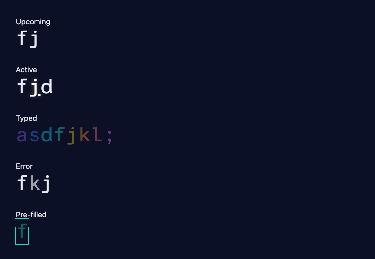

# Playtest

Captured from the browser test render of `TypedText`. The component is not mounted on a screen.

- [x] The active character is always the clearest thing on screen. In the Active row, `j` is white, underlined, and glowing. `f` and `d` stay the dimmer foreground. Vertical 10, typed-text states.
- [x] No effect covers the active character or the next two characters. N/A. This change does not run a level.
- [x] Keystroke response feels immediate (no visible delay). N/A. This change does not run a level.
- [x] Frame rate stays smooth during peaks (no visible stutter). N/A. This change does not run a level.
- [x] Errors are clear but not punishing. The Error row holds `k` in the static color after one 100ms flicker.
- [x] Audio fits the zone and never clips. N/A. This change does not run a level.
- [x] Pausing, losing focus, and resuming work. N/A. This change does not run a level.
- [x] The change matches vertical 10's typed-text state table and horizontal 07's mono face. Upcoming is bright, active is the white glow, typed characters are dim finger colors, the error is the static gray, and the pre-filled `f` has a dotted outline.

The component is not on a screen, so this checklist does not ask Karim to play a level for feel.
